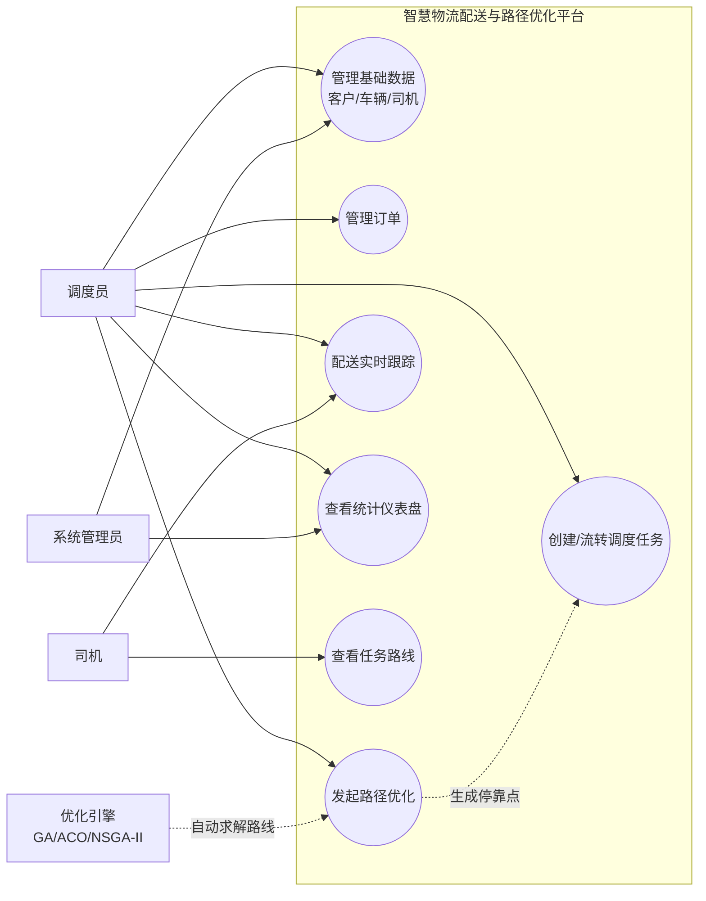
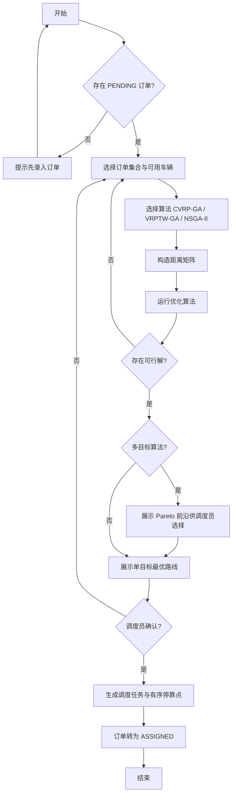
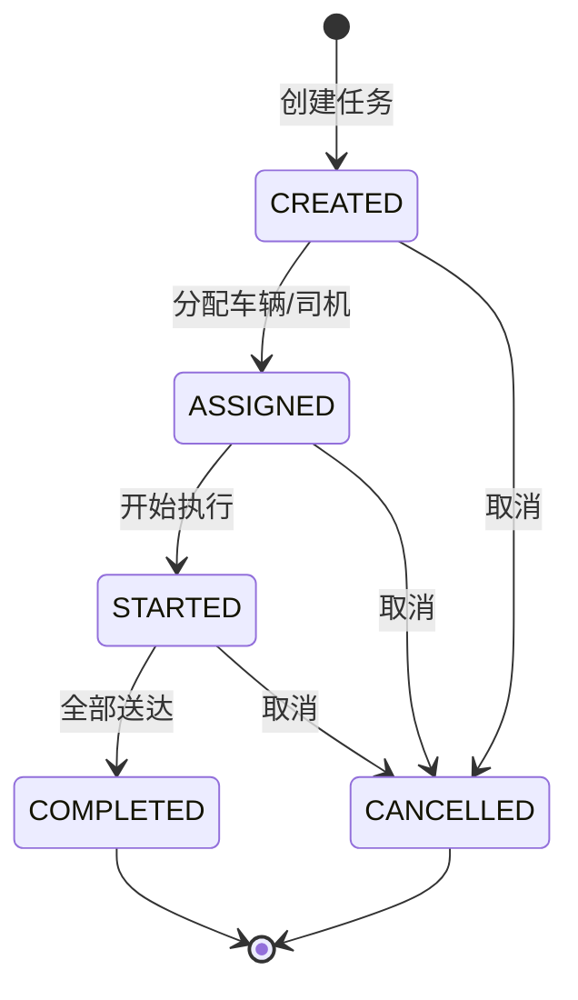
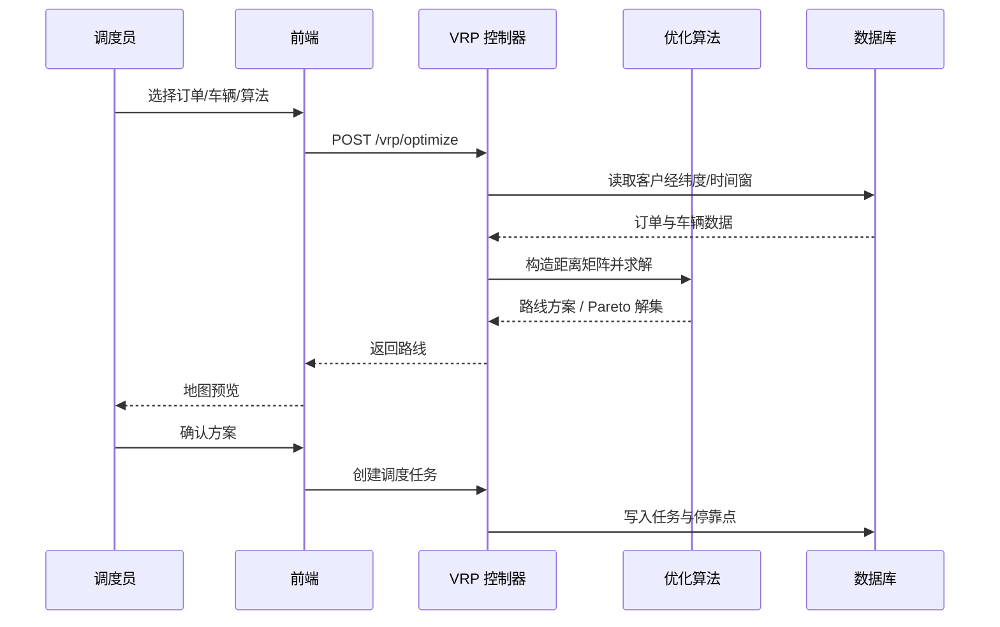

# 智慧物流配送与路径优化平台 — 需求文档

> 版本：v1.0　日期：2026-10-11　状态：已评审
> 关联文档：[02-系统设计文档](02-系统设计文档.md)、[03-算法文档](03-算法文档.md)、[05-测试文档](05-测试文档.md)

---

## 1. 引言

### 1.1 项目背景与目的

传统物流配送依赖人工排线，存在路线不合理、车辆利用率低、无法满足客户时间窗等问题。本项目旨在构建一个**智慧物流配送与路径优化平台**，通过 VRP（车辆路径问题）智能优化算法（遗传算法 GA、蚁群算法 ACO、多目标 NSGA-II）自动生成配送路线，并提供订单、车辆、司机、调度任务的全流程管理与实时跟踪能力。

### 1.2 项目范围

| 包含 | 不包含 |
|---|---|
| 客户/订单/车辆/司机/调度任务的管理与状态流转 | 真实计费、结算、发票 |
| VRP 路径优化（CVRP-GA / VRPTW / NSGA-II） | 真实车辆 GPS 硬件接入 |
| WebSocket 配送状态实时推送 | 用户注册/登录鉴权体系（课程演示环境） |
| 地图可视化、管理页面、统计仪表盘 | 多租户、国际化 |

### 1.3 术语定义

| 术语 | 说明 |
|---|---|
| VRP | Vehicle Routing Problem，车辆路径问题 |
| CVRP | 带容量约束的 VRP（车辆载重/容积限制） |
| VRPTW | 带时间窗约束的 VRP（客户要求送达时间区间） |
| 时间窗 | 客户可接受服务的起止时间 [timeWindowStart, timeWindowEnd] |
| 调度任务 | 一次配送执行单元：车辆 + 司机 + 一组有序停靠点 |
| 停靠点（DispatchStop） | 调度任务中按序访问的订单节点，即算法输出的路线 |

---

## 2. 用户角色

| 角色 | 描述 | 主要操作 |
|---|---|---|
| 调度员（核心用户） | 物流公司调度中心人员 | 维护客户/车辆/司机、录入订单、发起路径优化、创建与跟踪调度任务 |
| 系统管理员 | 平台运维人员 | 维护基础数据、监控任务执行、查看统计报表 |
| 司机 | 执行配送的驾驶员 | 查看分配的任务与路线、开始/完成任务（状态反馈） |
| 客户（间接用户） | 收货方 | 提出带时间窗的收货需求，被动接收配送 |

> 课程演示环境下，上述角色统一通过 Web 前端操作，暂不做登录鉴权区分。

---

## 3. 功能需求

### 3.1 功能总览

| 编号 | 功能模块 | 说明 | 优先级 |
|---|---|---|---|
| FR-1 | 基础数据管理 | 客户、车辆、司机的增删改查 | 高 |
| FR-2 | 订单管理 | 订单录入、状态流转、关联客户 | 高 |
| FR-3 | 调度任务管理 | 任务创建、分配、状态流转联动 | 高 |
| FR-4 | VRP 路径优化 | 输入订单与车辆 → 输出最优配送路线 | 高 |
| FR-5 | 配送实时跟踪 | WebSocket 推送任务/车辆状态 | 中 |
| FR-6 | 地图可视化 | 客户点、路线、车辆位置在地图上展示 | 中 |
| FR-7 | 统计分析仪表盘 | 配送完成率、车辆利用率、平均耗时等 | 中 |

### 3.2 FR-1 基础数据管理

**客户管理**
- 支持新增/修改/删除/查询客户，字段：名称、电话、地址、经纬度（lng/lat）、服务时间窗（起止）、单点服务时长
- 经纬度为路径优化与地图展示的必要字段，录入时必填校验

**车辆管理**
- 字段：车牌号（唯一）、载重上限 capacityW、容积上限 capacityV、状态
- 状态机：`IDLE（空闲）→ ON_DUTY（执行任务中）→ IDLE`；`MAINTENANCE（维修中）`车辆不可被分配任务

**司机管理**
- 字段：姓名、电话、驾驶证号 license（唯一，重复返回 409）、状态
- 状态机：`AVAILABLE（可用）↔ ON_DUTY（执勤中）↔ OFF（休息）`

### 3.3 FR-2 订单管理

- 字段：所属客户（必填，外键）、货重 weight、体积 volume、优先级 priority、状态
- 状态机：`PENDING（待分配）→ ASSIGNED（已分配）→ IN_TRANSIT（配送中）→ DELIVERED（已送达）`；任一阶段可 `FAILED` / `CANCELLED`
- 仅 `PENDING` 状态订单可参与路径优化与调度分配

### 3.4 FR-3 调度任务管理

- 创建任务：选择车辆 + 司机 + 关联订单集合
- 状态机：`CREATED → ASSIGNED → STARTED → COMPLETED`，任一中间态可 `CANCELLED`
- **状态联动规则**（核心业务规则）：

| 流转 | 任务状态 | 车辆状态 | 司机状态 |
|---|---|---|---|
| CREATED → ASSIGNED | ASSIGNED | IDLE → ON_DUTY | AVAILABLE → ON_DUTY |
| ASSIGNED → STARTED | STARTED | 保持 ON_DUTY | 保持 ON_DUTY |
| STARTED → COMPLETED | COMPLETED | ON_DUTY → IDLE | ON_DUTY → AVAILABLE |
| → CANCELLED | CANCELLED | ON_DUTY → IDLE | ON_DUTY → AVAILABLE |

- 任务完成/取消后，关联订单状态同步更新（DELIVERED / 回退 PENDING）
- 任务记录总里程 totalDist、总成本 totalCost，停靠点序列即算法输出路线

### 3.5 FR-4 VRP 路径优化（核心）

**输入**
- 待配送订单集合（含客户经纬度、时间窗、货重/体积）
- 可用车辆集合（含载重/容积上限）；可选用途：配送中心坐标

**处理**
| 算法 | 场景 | 约束/目标 |
|---|---|---|
| CVRP-GA | 基础容量约束 | 车辆容量不超限，最小化总行驶距离 |
| VRPTW-GA | 容量 + 时间窗 | 时间窗违约计入惩罚，最小化总距离 + 惩罚 |
| NSGA-II | 多目标优化 | 同时优化：总距离 / 使用车辆数 / 时间窗违约，输出 Pareto 解集 |

**输出**
- 每辆车的访问站点序列（即 DispatchStop 的 seq 排序）
- 每条路线的总距离、总成本；多目标模式下输出 Pareto 前沿供调度员选择
- 提供 REST API：`POST /vrp/optimize`（输入订单/车辆 → 输出路线），结果一键写入调度任务

### 3.6 FR-5 配送实时跟踪

- 通过 WebSocket（socket.io）向前端推送任务状态变更、车辆/订单状态变更事件
- 前端收到事件后动态刷新地图上的车辆位置与任务状态，无需手动刷新页面

### 3.7 FR-6 地图可视化

- 在地图（高德/Leaflet）上展示：客户分布点、车辆当前位置、优化后的路线
- 支持查看单个调度任务的完整路线与各停靠点到达情况

### 3.8 FR-7 统计分析仪表盘

| 指标 | 说明 |
|---|---|
| 配送完成率 | DELIVERED 订单数 / 总订单数 |
| 车辆利用率 | ON_DUTY 车辆数 / 可用车辆总数 |
| 平均配送耗时 | 任务 startTime 至 endTime 的均值 |
| 时间窗满足率 | 无违约送达的停靠点占比 |

---

## 4. 用例模型

### 4.1 总体用例图

### 4.2 用例清单

| 编号 | 用例名称 | 主要参与者 | 优先级 | 关联功能需求 |
|---|---|---|---|---|
| UC-1 | 管理基础数据 | 调度员、系统管理员 | 高 | FR-1 |
| UC-2 | 管理订单 | 调度员 | 高 | FR-2 |
| UC-3 | 发起路径优化 | 调度员、优化引擎 | 高 | FR-4 |
| UC-4 | 创建并流转调度任务 | 调度员、司机 | 高 | FR-3 |
| UC-5 | 配送实时跟踪 | 调度员、司机 | 中 | FR-5 |
| UC-6 | 查看统计仪表盘 | 系统管理员、调度员 | 中 | FR-7 |
| UC-7 | 查看任务路线 | 司机、调度员 | 中 | FR-6 |

### 4.3 用例详述

**UC-1 管理基础数据（客户/车辆/司机）**

| 项 | 内容 |
|---|---|
| 参与者 | 调度员（主）、系统管理员 |
| 简要说明 | 对客户、车辆、司机三类基础数据进行新增、修改、删除、查询 |
| 前置条件 | 用户已进入平台管理页面 |
| 后置条件 | 基础数据持久化到数据库，列表刷新 |
| 基本流 | 1. 进入客户/车辆/司机管理页面；2. 点击"新增"，填写表单；3. 系统执行字段校验（必填项、经纬度数值范围、车牌与驾驶证号唯一性）；4. 校验通过写入数据库并返回列表；5. 可对已有记录执行修改或删除 |
| 备选流 | 3a. 必填项缺失或格式非法：表单标红即时提示，不提交；3b. 车牌/驾驶证号重复：返回 409，提示"记录已存在"（BR-1/BR-2） |
| 异常流 | 删除被订单/任务引用的客户等记录时，提示存在关联数据并阻止删除 |
| 业务规则 | BR-1、BR-2、BR-3 |

**UC-2 管理订单**

| 项 | 内容 |
|---|---|
| 参与者 | 调度员 |
| 简要说明 | 录入配送订单，指定客户、货物信息与优先级，跟踪订单状态 |
| 前置条件 | 已存在至少一条客户记录 |
| 后置条件 | 订单以 PENDING 状态入库，可参与路径优化 |
| 基本流 | 1. 进入订单管理页，点击"新增"；2. 选择所属客户；3. 录入货重、体积、优先级；4. 校验通过后创建订单（PENDING）；5. 列表支持按状态筛选；6. 可修改订单信息或取消订单 |
| 备选流 | 2a. 客户不存在：提示先创建客户；6a. 取消已分配订单：提示需先从调度任务移除（BR-6） |
| 业务规则 | BR-6 |

**UC-3 发起路径优化**

| 项 | 内容 |
|---|---|
| 参与者 | 调度员（主）、优化引擎 |
| 简要说明 | 选择待配送订单与可用车辆，运行 VRP 算法生成最优配送路线 |
| 前置条件 | 存在 PENDING 状态订单；存在 IDLE 且非维修状态的车辆 |
| 后置条件 | 生成调度任务及有序停靠点，订单转为 ASSIGNED |
| 输入 | 订单集合（客户经纬度、时间窗、货重/体积）、可用车辆集合（载重/容积上限）、配送中心坐标、算法类型与参数 |
| 输出 | 每车访问站点序列、路线总距离/总成本；多目标模式输出 Pareto 前沿 |
| 基本流 | 1. 选择订单集合与可用车辆；2. 选择算法（CVRP-GA / VRPTW-GA / NSGA-II）；3. 系统构造距离矩阵并运行算法；4. 返回路线方案（多目标时展示 Pareto 前沿）；5. 调度员预览并确认方案 |
| 备选流 | 3a. 无可行解（容量/时间窗无法满足）：提示原因，允许调整输入重试 |
| 业务规则 | BR-6 |

**UC-4 创建并流转调度任务**

| 项 | 内容 |
|---|---|
| 参与者 | 调度员（主）、司机 |
| 简要说明 | 创建调度任务并绑定车辆司机，按状态机推进任务直至完成或取消 |
| 前置条件 | 车辆状态 IDLE、司机状态 AVAILABLE |
| 后置条件 | 任务进入终态（COMPLETED/CANCELLED），车辆与司机状态释放 |
| 基本流 | 1. 创建任务（CREATED）；2. 分配车辆与司机（ASSIGNED，车辆/司机转 ON_DUTY）；3. 开始执行（STARTED）；4. 司机依序送达停靠点；5. 全部送达后完成任务（COMPLETED，车辆转 IDLE、司机转 AVAILABLE），关联订单转 DELIVERED |
| 备选流 | 任意中间态取消（CANCELLED）：车辆/司机释放回 IDLE/AVAILABLE，关联订单回退 PENDING |
| 异常校验 | 分配维修中车辆或非可用司机时拒绝，返回 409（BR-3）；非法状态流转返回 400（BR-4） |
| 业务规则 | BR-3、BR-4、BR-5 |

**UC-5 配送实时跟踪**

| 项 | 内容 |
|---|---|
| 参与者 | 调度员、司机 |
| 简要说明 | 通过 WebSocket 实时推送任务与车辆状态，前端地图动态刷新 |
| 前置条件 | 存在 STARTED 状态任务；WebSocket 连接正常 |
| 后置条件 | 前端展示与后端状态一致 |
| 基本流 | 1. 前端建立 socket.io 连接并订阅事件；2. 后端监听任务/车辆/订单状态变更；3. 变更发生时推送事件；4. 前端刷新地图车辆位置与任务状态，无需手动刷新 |
| 备选流 | 1a. 连接断开：自动重连并拉取最新状态快照 |

**UC-6 查看统计仪表盘**

| 项 | 内容 |
|---|---|
| 参与者 | 系统管理员（主）、调度员 |
| 简要说明 | 聚合展示配送完成率、车辆利用率、平均耗时、时间窗满足率等指标 |
| 前置条件 | 系统内已有订单与任务数据 |
| 后置条件 | 仪表盘图表正确渲染 |
| 基本流 | 1. 进入仪表盘页面；2. 系统聚合订单/任务数据；3. ECharts 渲染指标图表；4. 支持按时间范围筛选 |

**UC-7 查看任务路线**

| 项 | 内容 |
|---|---|
| 参与者 | 司机（主）、调度员 |
| 简要说明 | 在地图上查看某调度任务的完整路线、停靠点顺序与到达情况 |
| 前置条件 | 调度任务已生成停靠点 |
| 后置条件 | 地图正确展示路线 |
| 基本流 | 1. 选择调度任务；2. 地图展示路线与停靠点；3. 查看各停靠点到达状态与客户信息 |

### 4.4 关键业务流程图

**路径优化业务流程**

**调度任务状态机**

**路径优化接口时序图**

---

## 5. 非功能需求

| 类别 | 编号 | 需求 |
|---|---|---|
| 性能 | NFR-1 | 单模块 CRUD 接口响应 < 200ms（常规数据量） |
| 性能 | NFR-2 | 50 客户规模 VRP 求解在 10s 内返回可用解 |
| 可靠性 | NFR-3 | 状态流转联动必须原子完成，禁止出现任务 ASSIGNED 而车辆仍 IDLE 的脏状态 |
| 易用性 | NFR-4 | 管理页面操作符合直觉，表单必填项即时校验提示 |
| 可维护性 | NFR-5 | 分层架构（Controller/Service/Prisma），统一通过 PrismaService 访问数据库 |
| 安全性 | NFR-6 | 全局参数校验（class-validator + ValidationPipe），非法入参返回 400 |
| 规范性 | NFR-7 | RESTful 接口风格，统一错误格式 `{ statusCode, message, error }`，Swagger 文档完备 |
| 可测试性 | NFR-8 | 核心模块具备 e2e 测试（Jest + supertest），覆盖状态流转联动 |

---

## 6. 业务规则与约束

### 6.1 业务规则

| 编号 | 规则 |
|---|---|
| BR-1 | 司机驾驶证号 license 全局唯一，重复创建返回 409 |
| BR-2 | 车牌号 plate 全局唯一 |
| BR-3 | 维修中车辆、非 AVAILABLE 司机不可被分配新任务 |
| BR-4 | 任务状态流转必须严格按状态机执行，非法流转返回 400 |
| BR-5 | 车辆/司机/订单状态随任务状态自动联动，不允许人工单独跳改造成不一致 |
| BR-6 | 仅 PENDING 订单可加入路径优化；已被任务占用的订单不可重复分配 |

### 6.2 技术约束

- 后端：NestJS 10 + TypeScript + Prisma 5 + PostgreSQL（PostGIS）
- 接口文档：Swagger（`/api/docs`）
- 前端：Vue3/React + 地图 SDK + ECharts
- 数据库访问统一走 PrismaService，Schema 变更必须提交 migration

---

## 7. 验收标准

1. 五大业务模块（customers/orders/vehicles/drivers/dispatch-tasks）CRUD 接口全部可用，Swagger 可访问
2. 调度任务状态流转正确联动车辆与司机状态，e2e 测试通过
3. 三种 VRP 算法均可运行并输出合理路线，多目标模式给出 Pareto 前沿
4. 前端可完成"录数据 → 优化路线 → 生成任务 → 地图跟踪 → 仪表盘查看"的完整闭环演示
5. 测试文档覆盖单元/接口/系统/性能四类用例，缺陷均已闭环
