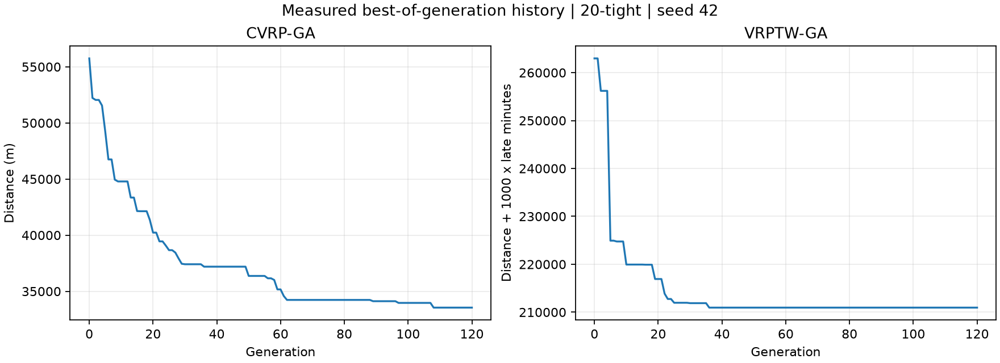
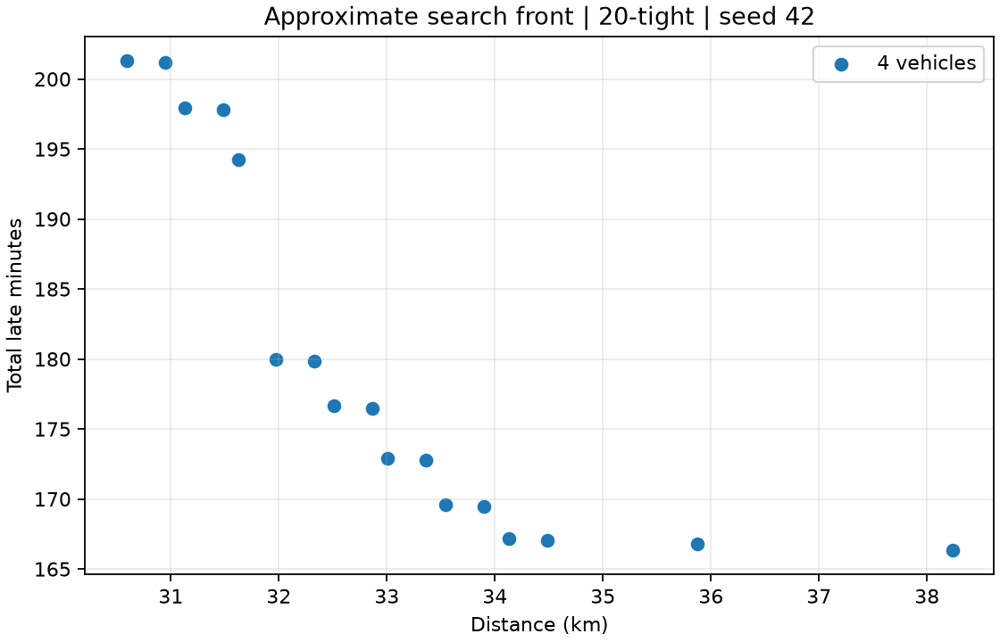

# 算法对比实验（自动生成）

生成时间：2026-10-13T02:37:02.095Z

## 实验范围

3 个合成场景 × 3 个随机种子 × 3 种算法，共 27 次。6-wide 为宽时间窗，20-tight、50-tight 为较紧时间窗。所有场景使用同一生成规则和相同容量、速度、服务时长。原始输入及所有候选方案保存在 results.json。

距离使用 Haversine 球面公式（地球半径 6371008.8 米），不是道路距离。本实验直接调用现有求解器，不读写数据库，也不生成调度任务。

CVRP 不优化时间窗，但本报告按相同速度和时间窗重新计算其迟到，便于比较。NSGA-II 保留全部方案，表格只展示距离最短的方案（平局依次比较车辆数和迟到），不能据此认定多目标算法整体优劣。

耗时只计求解器运行，不含数据库、PostGIS、HTTP、启动和文件保存；未单独预热，顺序执行，3 个种子不足以证明统计显著性。50 点小于 10 秒只能说明本机这些样本的求解器耗时，不代表端到端性能验收。

## 校验

27 次均检查完整且不重复覆盖订单、重量和体积容量、车辆不重复、路线距离；时间窗算法输出的迟到与独立重算一致。FOUND 不保证全局最优或无迟到。

环境：v24.20.0 / win32 / Intel(R) Core(TM) Ultra 5 125H

| 场景 | 种子 | 算法 | 距离(米) | 车辆数 | 迟到(分钟) | 方案数 | 求解耗时(ms) |
|---|---|---|---:|---:|---:|---:|---:|
| 6-wide | 7 | CVRP-GA | 15766.51 | 2 | 0.00 | 1 | 23.9 |
| 6-wide | 7 | VRPTW-GA | 15766.51 | 2 | 0.00 | 1 | 35.8 |
| 6-wide | 7 | NSGA-II | 15766.51 | 2 | 0.00 | 1 | 82.0 |
| 6-wide | 42 | CVRP-GA | 15766.51 | 2 | 0.00 | 1 | 12.7 |
| 6-wide | 42 | VRPTW-GA | 15766.51 | 2 | 0.00 | 1 | 15.6 |
| 6-wide | 42 | NSGA-II | 15766.51 | 2 | 0.00 | 1 | 20.8 |
| 6-wide | 123 | CVRP-GA | 15766.51 | 2 | 0.00 | 1 | 13.5 |
| 6-wide | 123 | VRPTW-GA | 15766.51 | 2 | 0.00 | 1 | 12.7 |
| 6-wide | 123 | NSGA-II | 15766.51 | 2 | 0.00 | 1 | 18.2 |
| 20-tight | 7 | CVRP-GA | 38272.03 | 4 | 273.21 | 1 | 18.2 |
| 20-tight | 7 | VRPTW-GA | 34270.15 | 4 | 153.06 | 1 | 39.6 |
| 20-tight | 7 | NSGA-II | 35301.38 | 4 | 309.03 | 10 | 52.9 |
| 20-tight | 42 | CVRP-GA | 33547.21 | 4 | 241.05 | 1 | 14.4 |
| 20-tight | 42 | VRPTW-GA | 38179.33 | 4 | 172.77 | 1 | 24.2 |
| 20-tight | 42 | NSGA-II | 30589.98 | 4 | 201.29 | 17 | 32.9 |
| 20-tight | 123 | CVRP-GA | 30890.47 | 4 | 359.67 | 1 | 18.0 |
| 20-tight | 123 | VRPTW-GA | 35620.57 | 4 | 178.24 | 1 | 29.2 |
| 20-tight | 123 | NSGA-II | 32970.72 | 4 | 225.11 | 12 | 30.7 |
| 50-tight | 7 | CVRP-GA | 80408.78 | 10 | 749.06 | 1 | 42.9 |
| 50-tight | 7 | VRPTW-GA | 73524.86 | 10 | 303.20 | 1 | 82.5 |
| 50-tight | 7 | NSGA-II | 88946.97 | 10 | 551.75 | 7 | 46.2 |
| 50-tight | 42 | CVRP-GA | 80737.49 | 10 | 925.03 | 1 | 37.8 |
| 50-tight | 42 | VRPTW-GA | 73585.32 | 10 | 286.47 | 1 | 76.2 |
| 50-tight | 42 | NSGA-II | 95994.99 | 10 | 621.17 | 6 | 49.5 |
| 50-tight | 123 | CVRP-GA | 78849.82 | 10 | 560.58 | 1 | 62.6 |
| 50-tight | 123 | VRPTW-GA | 72849.86 | 10 | 312.97 | 1 | 98.0 |
| 50-tight | 123 | NSGA-II | 87879.98 | 10 | 515.03 | 8 | 61.9 |

## 用户验证

在 backend 文件夹运行 pnpm.cmd run experiment:vrp，最后应显示 PASS: 27 runs。重复运行相同种子的路线结果应稳定，耗时会变化。此命令不会改变已有订单或任务状态。


## 收敛曲线



20-tight、seed=42，各记录初始种群及 120 轮迭代的最佳方案。CVRP 纵轴为米；VRPTW 为距离加 1000 倍迟到分钟数，二者纵轴不可直接比较。观察回调不改变随机搜索结果。平台期仅表示此轮搜索没有进一步改善，不证明已达到全局最优。

## 本次搜索的 Pareto 前沿



图中展示 20-tight、seed=42 的全部 NSGA-II 候选，而非仅展示表格中的最短距离方案。越靠左距离越短，越靠下迟到越少。本场景所有候选均使用 4 辆车，因此只展示距离与迟到的取舍；尚不能用这组图证明车辆数目标上的多样性。后续可增加备用车辆、异构容量数据。

## 图表复现

在 backend 目录依次运行：

```powershell
pnpm.cmd run experiment:vrp
pnpm.cmd run experiment:curves
python -m pip install matplotlib
python scripts/plot-experiments.py
```

图表输出到 docs/figures。curves.json 保存逐代原始分数，完整输入和解保存在 results.json。Python 仅用于重画图表，运行后端不需要 Python。
