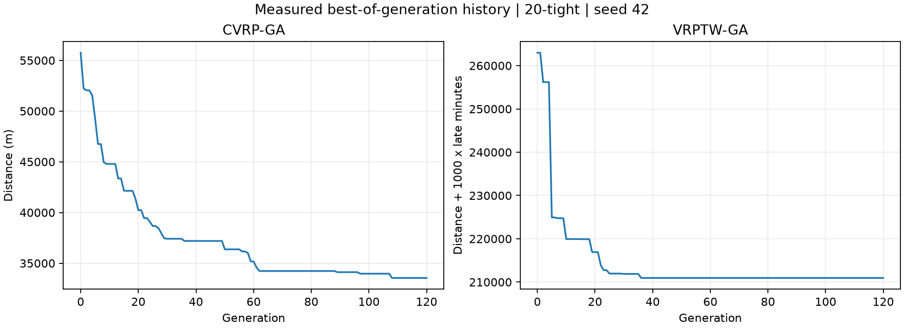
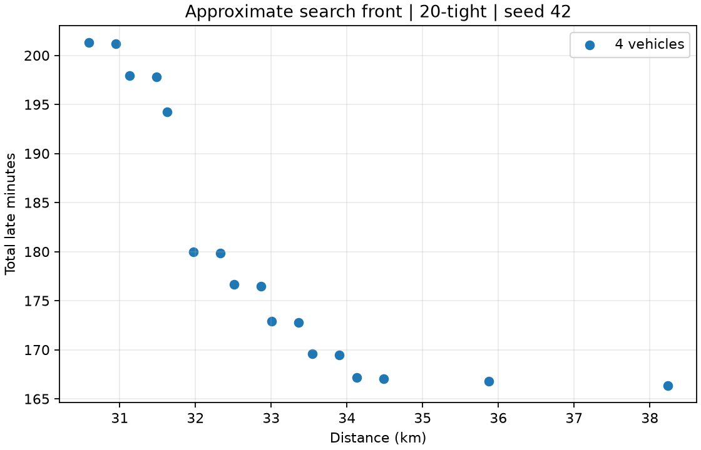

# 算法对比实验（自动生成）

生成时间：2026-11-12T05:46:22.115Z

## 实验范围

3 个合成场景 × 3 个随机种子 × 3 种算法，共 27 次。6-wide 为宽时间窗，20-tight、50-tight 为较紧时间窗。所有场景使用同一生成规则和相同容量、速度、服务时长。原始输入及所有候选方案保存在 results.json。

距离使用 Haversine 球面公式（地球半径 6371008.8 米），不是道路距离。本实验直接调用现有求解器，不读写数据库，也不生成调度任务。

CVRP 不优化时间窗，但本报告按相同速度和时间窗重新计算其迟到，便于比较。NSGA-II 保留全部方案，表格只展示距离最短的方案（平局依次比较车辆数和迟到），不能据此认定多目标算法整体优劣。

耗时只计求解器运行，不含数据库、PostGIS、HTTP、启动和文件保存；未单独预热，顺序执行，3 个种子不足以证明统计显著性。50 点小于 10 秒只能说明本机这些样本的求解器耗时，不代表端到端性能验收。

## 校验

27 次均检查完整且不重复覆盖订单、重量和体积容量、车辆不重复、路线距离；时间窗算法输出的迟到与独立重算一致。FOUND 不保证全局最优或无迟到。

环境：v24.14.0 / win32 / Intel(R) Core(TM) Ultra 5 125H

| 场景 | 种子 | 算法 | 距离(米) | 车辆数 | 迟到(分钟) | 方案数 | 求解耗时(ms) |
|---|---|---|---:|---:|---:|---:|---:|
| 6-wide | 7 | CVRP-GA | 15766.51 | 2 | 0.00 | 1 | 112.1 |
| 6-wide | 7 | VRPTW-GA | 15766.51 | 2 | 0.00 | 1 | 110.8 |
| 6-wide | 7 | NSGA-II | 15766.51 | 2 | 0.00 | 1 | 108.5 |
| 6-wide | 42 | CVRP-GA | 15766.51 | 2 | 0.00 | 1 | 92.3 |
| 6-wide | 42 | VRPTW-GA | 15766.51 | 2 | 0.00 | 1 | 90.8 |
| 6-wide | 42 | NSGA-II | 15766.51 | 2 | 0.00 | 1 | 63.7 |
| 6-wide | 123 | CVRP-GA | 15766.51 | 2 | 0.00 | 1 | 80.0 |
| 6-wide | 123 | VRPTW-GA | 15766.51 | 2 | 0.00 | 1 | 91.0 |
| 6-wide | 123 | NSGA-II | 15766.51 | 2 | 0.00 | 1 | 57.3 |
| 20-tight | 7 | CVRP-GA | 30219.78 | 4 | 344.71 | 1 | 254.6 |
| 20-tight | 7 | VRPTW-GA | 36111.11 | 4 | 170.12 | 1 | 353.4 |
| 20-tight | 7 | NSGA-II | 30219.78 | 4 | 228.90 | 5 | 260.1 |
| 20-tight | 42 | CVRP-GA | 30952.52 | 4 | 319.35 | 1 | 317.7 |
| 20-tight | 42 | VRPTW-GA | 36758.74 | 4 | 183.09 | 1 | 336.0 |
| 20-tight | 42 | NSGA-II | 31074.40 | 4 | 240.58 | 6 | 258.7 |
| 20-tight | 123 | CVRP-GA | 30219.78 | 4 | 250.04 | 1 | 314.0 |
| 20-tight | 123 | VRPTW-GA | 34642.26 | 4 | 183.55 | 1 | 346.3 |
| 20-tight | 123 | NSGA-II | 30890.47 | 4 | 300.85 | 8 | 250.4 |
| 50-tight | 7 | CVRP-GA | 67419.29 | 10 | 639.38 | 1 | 882.0 |
| 50-tight | 7 | VRPTW-GA | 82362.73 | 10 | 406.96 | 1 | 946.0 |
| 50-tight | 7 | NSGA-II | 89758.74 | 10 | 669.40 | 7 | 745.3 |
| 50-tight | 42 | CVRP-GA | 69759.10 | 10 | 768.21 | 1 | 891.1 |
| 50-tight | 42 | VRPTW-GA | 76853.51 | 10 | 359.24 | 1 | 1052.9 |
| 50-tight | 42 | NSGA-II | 85297.31 | 10 | 741.70 | 11 | 748.7 |
| 50-tight | 123 | CVRP-GA | 67615.05 | 10 | 629.87 | 1 | 903.9 |
| 50-tight | 123 | VRPTW-GA | 83589.21 | 10 | 463.73 | 1 | 1079.0 |
| 50-tight | 123 | NSGA-II | 86655.90 | 10 | 728.01 | 8 | 746.2 |

## 用户验证

在 backend 文件夹运行 pnpm.cmd run experiment:vrp，最后应显示 PASS: 27 runs。重复运行相同种子的路线结果应稳定，耗时会变化。此命令不会改变已有订单或任务状态。


## 收敛曲线



20-tight、seed=42，各记录初始种群及 120 轮迭代的最佳方案。CVRP 纵轴为米；VRPTW 为距离加 1000 倍迟到分钟数，二者纵轴不可直接比较。观察回调不改变随机搜索结果。平台期仅表示此轮搜索没有进一步改善，不证明已达到全局最优。

## 本次搜索的 Pareto 前沿



图中展示 20-tight、seed=42 的全部 NSGA-II 候选，而非仅展示表格中的最短距离方案。越靠左距离越短，越靠下迟到越少。本场景所有候选均使用 4 辆车，因此只展示距离与迟到的取舍；尚不能用这组图证明车辆数目标上的多样性。后续可增加备用车辆、异构容量数据。

## 图表复现

在 backend 目录依次运行：

```powershell
pnpm.cmd run experiment:vrp
pnpm.cmd run experiment:curves
python -m pip install matplotlib
python scripts/plot-experiments.py
```

图表输出到 docs/figures。curves.json 保存逐代原始分数，完整输入和解保存在 results.json。Python 仅用于重画图表，运行后端不需要 Python。
